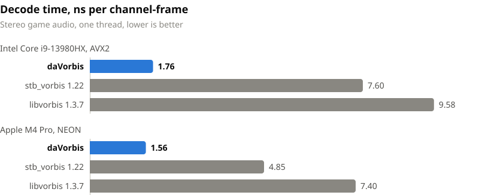

# daVorbis: a Vorbis decoder up to 4.3 times as fast as stb_vorbis and 5.4 times as fast as libvorbis

daVorbis is a Vorbis I audio decoder for games, written from the Vorbis I specification in about 1,700 lines
of C++17. It decodes the raw Vorbis packets that game sound banks store, and it does it fast:

- **4.1 to 4.3 times the speed of stb_vorbis 1.22 and 5.0 to 5.4 times the speed of libvorbis 1.3.7** on a
  desktop PC with AVX2 (3.5 to 3.6 and 4.1 to 4.6 times at the base level);
  3.0 to 3.1 and 4.4 to 4.7 times on an Apple M4 Pro.
- **Faster than an optimized proprietary decoder** on every machine that we measured: 0.64 to 0.87 of its
  decode time, on PC and on two console generations.
- **The same quality as libvorbis**: 134.8 dB SNR against the libvorbis output on the worst sample.
- **No allocation, no threads, no files.** The caller gives all memory, and each call states its memory size.
- **SSE, AVX and AVX2**, picked at run time on a PC, and **NEON** on arm64.

Licence: BSD 3-Clause. The only dependency is [vecmath](https://github.com/GaijinEntertainment/vecmath),
the header-only SIMD library of the Dagor engine, as a git submodule. The files, the build and the full
numbers are in [DETAILS.md](DETAILS.md).

## Speed

Decode time to float, nanoseconds for each frame of one channel, one thread. The streams are 164 Vorbis
samples of game sound banks (14 setups, 8 to 48 kHz, 250 million channel-frames). The chart shows the stereo
column of the table.

<picture>
  <source media="(prefers-color-scheme: dark)" srcset="docs/speed-dark.svg">
  
</picture>

| Decoder | Mono | Stereo | 4 channels |
|---|---|---|---|
| daVorbis, AVX2, Intel Core i9-13980HX | **1.85** | **1.76** | **1.70** |
| daVorbis, base level, same PC | 2.15 | 2.09 | 2.06 |
| stb_vorbis 1.22, same PC | 7.66 | 7.60 | 7.21 |
| libvorbis 1.3.7, same PC | 9.18 | 9.58 | 8.48 |
| daVorbis, NEON, Apple M4 Pro | **1.64** | **1.56** | **1.46** |
| stb_vorbis 1.22, Apple M4 Pro | 4.87 | 4.85 | 4.47 |
| libvorbis 1.3.7, Apple M4 Pro | 7.25 | 7.40 | 6.43 |

Against an optimized proprietary decoder, on 2,419 Vorbis samples of game sound banks with int16 output.
The number is the daVorbis time divided by the time of the other decoder:

| Machine | Time ratio | daVorbis, ns for each int16 value |
|---|---|---|
| PC, AVX level | 0.64 | 2.06 |
| PC, AVX2 level | 0.68 | 1.98 |
| PC, base level | 0.73 | 2.38 |
| current console generation | 0.76 | 2.97 |
| previous console generation | 0.87 | 17.11 |

Each setup, taken by itself, is faster on each machine.

## Quality

The float output of daVorbis and of stb_vorbis against the float output of libvorbis, sample by sample:

| Decoder | SNR of the worst sample | Largest absolute difference |
|---|---|---|
| daVorbis, base | 134.8 dB | 7.2e-7 |
| daVorbis, AVX2 | 134.9 dB | 7.2e-7 |
| daVorbis, NEON, Apple M4 Pro | 135.3 dB | 7.8e-7 |
| stb_vorbis 1.22 | 142.8 dB | 4.2e-7 |
| stb_vorbis 1.22, Apple M4 Pro | 137.0 dB | 7.2e-7 |

That is far under what any ear can hear: the difference is under one step of 16-bit PCM.

## How it gets its speed

1. **One load for the bit reader.** A 64-bit window refilled by one 8-byte load serves as many code words
   as fit in it.
2. **Code words in one table read.** Each book has a 1024-entry table; only a code longer than 10 bits,
   or one whose value does not fit a table entry, takes a second step. Vectors of 2, 4 and 8 values have
   their own loops, and a stereo residue writes directly into the two channels.
3. **A floor in SIMD.** The integer line of the specification is computed for 4 or 8 bins at a time.
4. **Half an inverse MDCT.** The transform is an FFT of a quarter of the block size with a rotation before
   and after, and only the middle half of the output is computed: the outer quarters are mirrors.
5. **Memory that the cache likes.** The work vectors of two channels are not a multiple of 4 KiB apart, so
   a load does not wait for a store at the same low address bits.

## Build

```
git clone --recursive https://github.com/GaijinEntertainment/daVorbis.git
cmake -S daVorbis -B build -DCMAKE_BUILD_TYPE=Release
cmake --build build --config Release
```

A project with its own CMake build adds the folder with `add_subdirectory` and links `daVorbis`. A clone
made without `--recursive` needs `git submodule update --init` before the build.

## Use

```cpp
#include <daVorbis/daVorbis.h>
using namespace dacodecs;

// 0 bytes or a null is a failure: check each result before the next call. A read can give fewer frames.
DaVorbisConfig cfg = {channels, 256, 2048, DaVorbisIsa::AUTO};
uint32_t setupBytes = davorbis_setup_bytes(packet, packetBytes, cfg, &status);
const DaVorbisSetup *setup = davorbis_setup_parse(packet, packetBytes, cfg, setupMem, setupBytes, &status);

uint32_t decoderBytes = davorbis_decoder_bytes(setup, channels);
DaVorbisDecoder *dec = davorbis_decoder_open(setup, channels, decoderMem, decoderBytes, &status);

DaVorbisStream stream = {payload, payloadBytes, 0}; // a u16 LE byte count before each packet, 0 ends it
uint32_t got = davorbis_stream_read_float(dec, &stream, out, frames, &status);
```

- A setup is parsed one time and is read-only after that: all decoders on all threads share it.
- A decoder is the state of one stream: about 6.4 KB for each channel at the usual 2048-frame long block.
- Both memory blocks come from the caller, 32-byte aligned; no call allocates.
- Output is interleaved float or saturated int16, both from one pass over the decoded frames.
- 16 bytes after each packet must be readable (`DAVORBIS_PACKET_PAD`); they are never used as data.

The full contract of each call is in [`include/daVorbis/daVorbis.h`](include/daVorbis/daVorbis.h).

## What it decodes

Floor type 1, residue types 0, 1 and 2, 1 to 8 channels, block sizes 64 to 8192: the streams of the
libvorbis encoder up to 8 channels. Floor type 0 is refused with a status, not decoded. The Ogg container and the
identification and comment headers are not read: the caller gives the channel count and the two block sizes.

## How we measured

- The three decoders read the same packets from memory; the setup parse and the decoder open are not timed.
- stb_vorbis reads Ogg pages only, so the packets go into Ogg pages with the identification, comment and
  setup headers that libvorbis gets. Only its `stb_vorbis_get_frame_float` calls are timed.
- Each sample of the three decoders: the best of 5 runs. A row: the sum of times over the sum of
  channel-frames. The rows of daVorbis, stb_vorbis and libvorbis on one machine come from one session: the
  PC on 2026-11-16, the M4 Pro on 2026-11-17.
- One compiler and option set for the three decoders: clang-cl 21.1.8 on the PC, Apple clang 21 on the
  M4 Pro, with the release options of the Dagor engine ([DETAILS.md](DETAILS.md) gives each option). On the PC a
  CMake Release build of daVorbis decodes within 6% of these times with clang-cl, and 5% to 11% slower
  with MSVC 19.38.
- The quality reference on the PC is a libvorbis 1.3.7 build with no fast math; on the M4 Pro it is the
  libvorbis build that is timed there.
